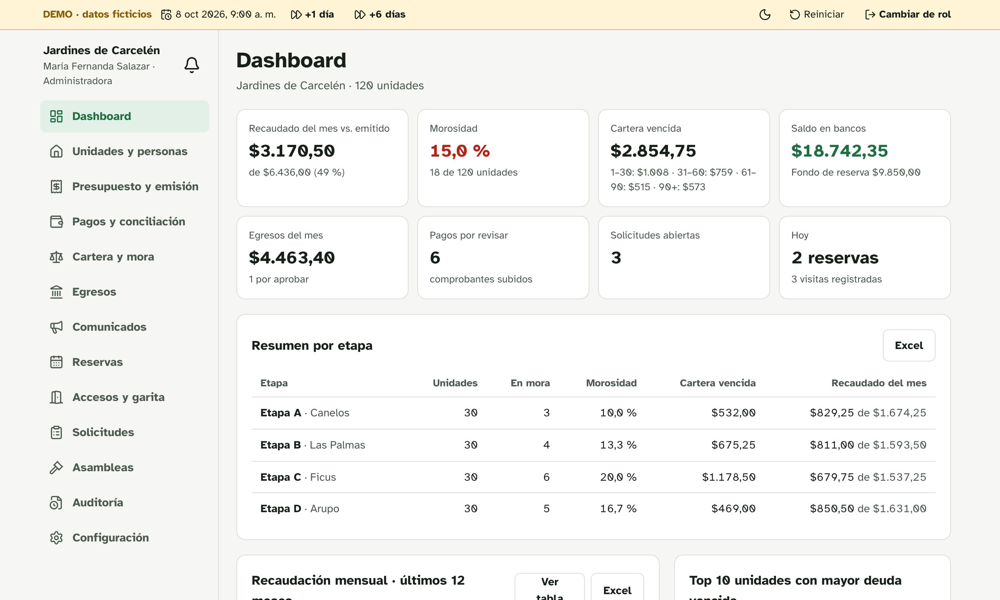
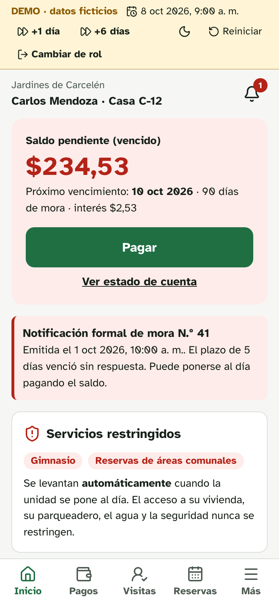
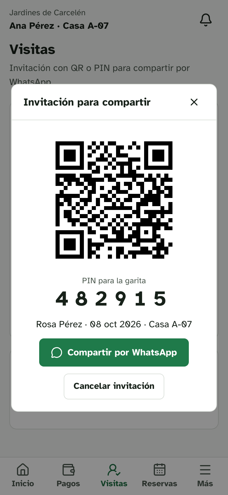
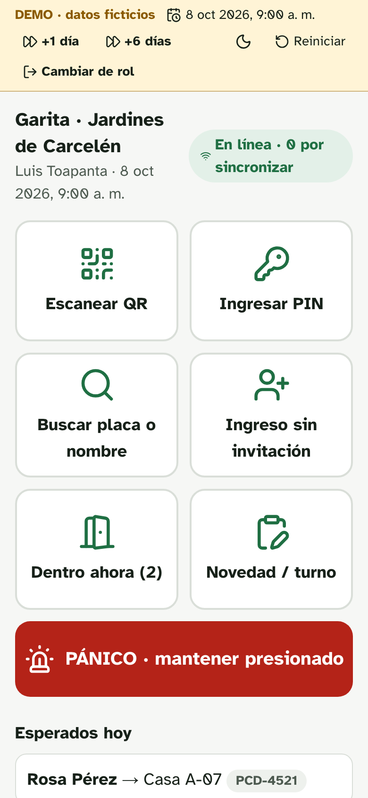
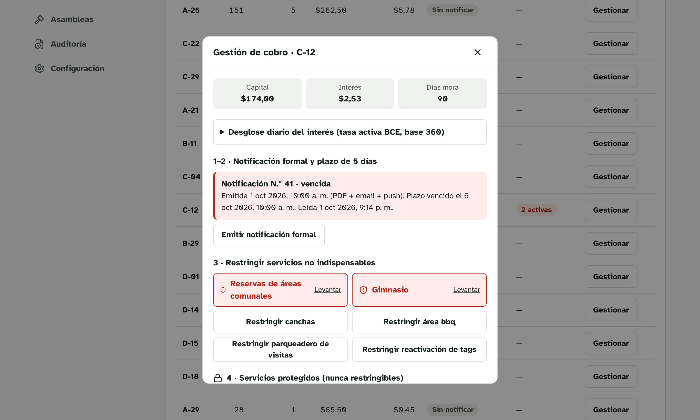
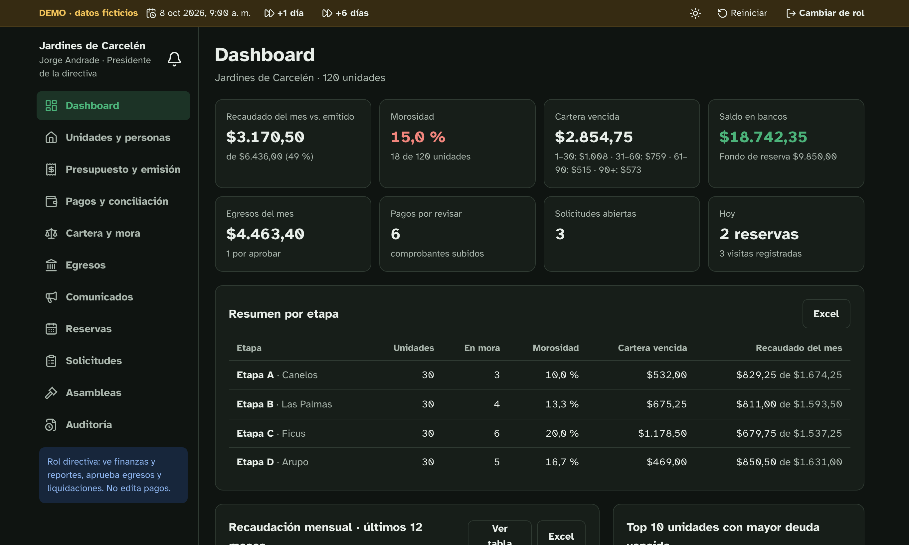

  

 

  

## Sobre el proyecto

Una plataforma para **administrar conjuntos residenciales privados en Ecuador**: alícuotas, cobranza, garita, reservas, solicitudes y asambleas, con una interfaz para cada perfil (administración, directiva, contador, guardia, propietario e inquilino).

El demo recrea el conjunto piloto **Jardines de Carcelén**, una urbanización de 120 casas en la Panamericana Norte, en Quito, organizada en **4 etapas (A, B, C y D)**, una por calle (Canelos, Las Palmas, Ficus y Arupo), con sus áreas comunales y un 15 % de unidades en mora. **Todo es interactivo**: puedes aprobar pagos, emitir expensas, restringir servicios, crear visitas con QR o votar en la asamblea. Los cambios se guardan solo en tu navegador, y el botón **Reiniciar** vuelve todo al estado inicial.

> Todos los datos son ficticios: nombres, cédulas, placas, RUC y tasas de interés.

<table>
<tr>
<td width="33%"> <b>Propietario en mora</b> saldo, notificación y servicios restringidos</td>
<td width="33%"> <b>Visitas con QR y PIN</b> se comparten por WhatsApp</td>
<td width="33%"> <b>Garita</b> botones grandes, PIN y pánico</td>
</tr>
</table>

## Pruébalo en 2 minutos

1. Entra como **Carlos Mendoza** (casa C‑12, en mora). Verás su deuda, la notificación formal y que no puede reservar el gimnasio.
2. En **Pagar**, sube un comprobante (el archivo no sale de tu navegador).
3. Cambia a **Patricio Ortiz** (contador) y apruébalo en **Pagos**. Las restricciones de Carlos **se levantan en el acto** y su casa queda habilitada para votar.
4. Como **María Fernanda** (administradora), en **Cartera**, intenta restringir el *agua* de una casa. El sistema no lo permite. Intenta restringir la casa con la notificación N.º 43, emitida hace solo 2 días: tampoco se puede. Pulsa **+6 días** en la barra superior y vuelve a intentarlo.
5. Como **Ana Pérez**, crea una visita; luego entra como **Luis** (guardia) y regístrala con el PIN.

## Lo que hace

| Módulo | Qué se puede hacer en el demo |
|---|---|
| **Dashboard** | Resumen por etapa (A–D), recaudado vs. emitido, % de morosidad, cartera a 30/60/90+ días, bancos, egresos; recaudación de 12 meses y top 10 de unidades morosas (con vista de tabla y exportación a Excel). |
| **Expensas** | Presupuesto anual por rubros y emisión mensual por % de alícuota. La suma cuadra al centavo y la emisión es idempotente. |
| **Pagos** | Bandeja de comprobantes, aprobar o rechazar con motivo, conciliación bancaria con sugerencias, recibos secuenciales y pagos en efectivo. |
| **Cartera y mora** | Interés diario por tramos de tasa, notificación formal con constancias, plazo de 5 días, restricciones, liquidaciones con alerta de 30 días y publicación mensual sin nombres. |
| **Comunicados** | Segmentación (todos, etapa, morosos, propietarios), canales push, email y WhatsApp, y % de lectura. |
| **Reservas** | Calendario por área, cobro como cargo, garantías y bloqueo automático por mora. |
| **Garita** | QR, PIN, búsqueda por placa, ingreso sin invitación con autorización del residente, quién está dentro y botón de pánico. |
| **Solicitudes** | Tablero con SLA, comentarios y calificación. |
| **Asambleas** | Quórum por alícuota (solo unidades al día) y votación ponderada; las unidades en mora no pueden votar. |
| **Auditoría** | Bitácora de cada acción financiera con usuario, fecha, valor anterior y valor nuevo. |

## Reglas de cobranza (Decreto Ejecutivo 462)

  

- **Mora** desde el día siguiente al vencimiento, con **interés simple diario** a la tasa vigente de cada tramo (sin intereses sobre intereses).
- **Notificación formal** primero, y **5 días** para pagar, justificar, observar o pedir un convenio.
- Solo se restringen **servicios no indispensables**: reservas, gimnasio, canchas, BBQ, parqueadero de visitas y reactivación de tags.
- **Nunca** se puede restringir el acceso a la vivienda, el parqueadero propio, el agua, la seguridad ni las rutas de evacuación.
- Al quedar al día, las restricciones **se levantan solas, de inmediato**.
- Imputación de pagos: gastos de cobranza → intereses → capital, de la deuda más antigua a la más reciente.

## Accesible y para todos

Tipografía **Atkinson Hyperlegible**, pensada para personas con baja visión; tamaño de texto ajustable (normal, grande, muy grande); contraste AA; **modo oscuro**; botones de 64 px en garita; diseño móvil primero para residentes.

  

## Tecnología

Next.js · TypeScript · Tailwind CSS · Recharts · PWA. La versión de producción usa **Supabase** (Postgres con *Row Level Security* por conjunto, Auth, Storage, pg_cron); este demo es un prototipo estático que simula el backend en el navegador.

## Estado

**Demo interactivo con datos simulados.** La aplicación de producción (multi‑conjunto, base de datos con aislamiento por conjunto, PDFs, notificaciones reales, pagos en línea y facturación electrónica del SRI) está en desarrollo.

**El código fuente es privado.** Este repositorio contiene solo la versión compilada del demo.

